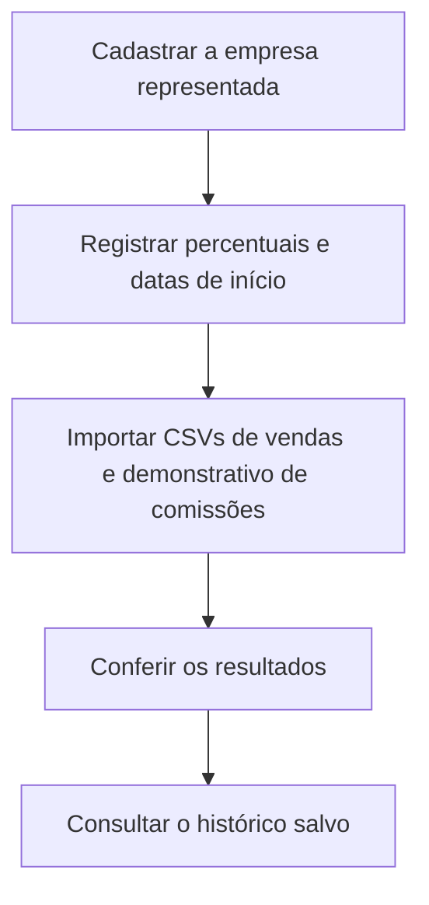

# Project Conferidor

Aplicação para conferir comissões de vendas. Compara o valor de comissão informado por uma empresa representada com o valor calculado a partir das vendas e dos percentuais acordados.

O projeto oferece um núcleo para uso e adaptação por diferentes empresas. Integrações e recursos específicos podem ser desenvolvidos por quem utilizar a aplicação.

## Fluxo de uso



Para cada venda, a aplicação usa o acordo mais recente vigente na data da venda e calcula a comissão sobre o valor bruto faturado. Por exemplo, uma venda de R$ 10.000,00 com percentual de 5% gera uma comissão esperada de R$ 500,00.

Os arquivos são relacionados pelo identificador da venda. Os cálculos usam `decimal`, com arredondamento para centavos; valores exatamente no meio são arredondados para longe de zero. O histórico preserva os valores e o percentual utilizados em cada conferência.

## Resultados

| Resultado | Significado |
| --- | --- |
| Conferido | Comissão esperada e informada coincidem. |
| Divergência | Os valores são diferentes. |
| Sem registro no demonstrativo | Existe venda, mas falta comissão informada. |
| Venda não localizada | Existe comissão no demonstrativo, mas a venda não foi encontrada. |
| Sem acordo vigente | Não existe percentual aplicável à data da venda. |

A diferença é calculada como **comissão esperada − comissão informada**. Um valor positivo indica comissão informada abaixo da esperada. Quando não é possível comparar os valores, a diferença fica sem valor.

## Instalação e execução

Requisitos: SDK do .NET 10 e Node.js 22.12 ou superior em uma versão compatível com Vite 8, com npm. Execute os comandos a partir da raiz do projeto.

Na primeira execução, instale as dependências e gere a interface:

```sh
cd web
npm install
npm run build
cd ..
```

Inicie a aplicação:

```sh
dotnet run --project src/ProjectConferidor.Api
```

Acesse **http://127.0.0.1:5080**. A API serve a interface gerada em `src/ProjectConferidor.Api/wwwroot`. Gere-a novamente quando alterar o frontend.

Os dados ficam no arquivo `project-conferidor.db`, na pasta `ProjectConferidor` do diretório de dados locais do usuário. Para escolher outra pasta, defina a variável de ambiente `PROJECT_CONFERIDOR_DATA_DIR` antes de iniciar a aplicação. Não é necessário instalar um servidor de banco de dados.

Para fazer um backup manual, pare a aplicação e copie a pasta de dados inteira. Para restaurar, com a aplicação parada, recoloque a cópia na pasta de dados configurada.

## Como usar

1. Cadastre e selecione uma empresa representada.
2. Registre os acordos com percentual e data de início. Informe `5` para representar 5%.
3. Em **Nova conferência**, selecione o CSV de vendas e o demonstrativo de comissões.
4. Se necessário, configure as colunas e os formatos dos arquivos, valide a prévia e salve um perfil de importação para reutilizar.
5. Execute a conferência. Consulte os resultados, filtre as linhas e acesse as execuções anteriores no histórico.

Para experimentar, siga o [exemplo completo](example/README.md), com arquivos fictícios e resultados esperados. A pasta [samples](samples/) contém arquivos menores para uma conferência rápida.

### Arquivos CSV

No formato padrão, os arquivos devem conter estas colunas:

| Arquivo | Cabeçalhos |
| --- | --- |
| Vendas | `sale_id,sale_date,gross_amount` |
| Demonstrativo | `sale_id,commission_amount` |

Também são aceitos os nomes `id_venda`, `data_venda`, `valor_bruto` e `valor_comissao`. Outros layouts podem ser mapeados pela configuração de importação.

No formato padrão, use vírgula como separador com valores como `1250.50`, ou ponto e vírgula com valores como `1.250,50`. As datas aceitas são `yyyy-MM-dd` e `dd/MM/yyyy`. Na importação configurada, o formato numérico pode ser escolhido independentemente do separador.

O arquivo de vendas deve conter uma linha por identificador. Entradas repetidas no demonstrativo são somadas por venda. Se houver registros inválidos, a conferência é rejeitada sem salvar um resultado parcial. A interface limita o tamanho combinado dos arquivos a 9 MB.

Os resultados e as configurações utilizadas são salvos; os arquivos originais não são armazenados. Guarde-os caso precise repetir a importação.

## Arquitetura

| Diretório | Responsabilidade |
| --- | --- |
| `src/ProjectConferidor.Domain` | Modelos e regras de negócio: vendas, acordos e conferência. |
| `src/ProjectConferidor.Application` | Casos de uso, validações e contratos de acesso a dados e arquivos. |
| `src/ProjectConferidor.Infrastructure` | Leitura dos CSVs e persistência em SQLite, sem ORM. |
| `src/ProjectConferidor.Api` | API HTTP em ASP.NET Core com .NET 10 e hospedagem da interface. |
| `web/` | Interface em Svelte 5, TypeScript, Vite e componentes do Carbon Design System, da IBM. |
| `tests/` | Verificações de persistência, importação e regras de conferência. |
| `web/tests/` | Verificações de importação, filtros, entradas financeiras e operações da interface. |

A interface chama a API, que aciona os casos de uso. Eles coordenam as regras de negócio e a persistência por contratos implementados na infraestrutura. O domínio permanece independente do banco e da interface.

A interface e esta documentação estão em pt-BR. As rotas e respostas da API permanecem em inglês; a interface trata as mensagens para o usuário.

## Desenvolvimento

Para trabalhar na interface, mantenha a API em execução e abra outro terminal:

```sh
cd web
npm run dev
```

Acesse **http://127.0.0.1:5173**. O Vite encaminha as requisições da API para a porta 5080.

Verificações disponíveis, a partir da raiz:

```sh
dotnet run --project tests/ProjectConferidor.Persistence.Checks
cd web
npm run web:test
npm run web:typecheck
```

Para validar o fluxo HTTP com banco temporário e seguir o roteiro de aceite da interface, consulte a [validação ponta a ponta](tests/e2e/README.md).

### Desenvolvimento de extensões

**TODO:** documentar os pontos de extensão e o fluxo para acrescentar leitores, regras de cálculo e integrações desenvolvidas por terceiros, como ERP e serviços bancários.

## Limitações e próximos passos

O projeto está em fase de protótipo. Não contempla recebimentos parciais, estornos, gestão de contestações ou integração bancária. O cálculo atual se limita ao percentual sobre o valor bruto da venda.

A API não possui autenticação e escuta apenas no endereço local por padrão. O uso em rede exige definir e configurar o controle de acesso. Excluir uma empresa remove seus acordos, perfis de importação e histórico; a limpeza do banco remove todos os registros da aplicação.

As etapas de evolução estão no [roadmap](ROADMAP.md).

## Licença

Projeto de rosa gus, distribuído sob a [licença Apache 2.0](LICENSE). Consulte [NOTICE](NOTICE) para atribuições. Dependências e fontes mantêm suas próprias licenças.
